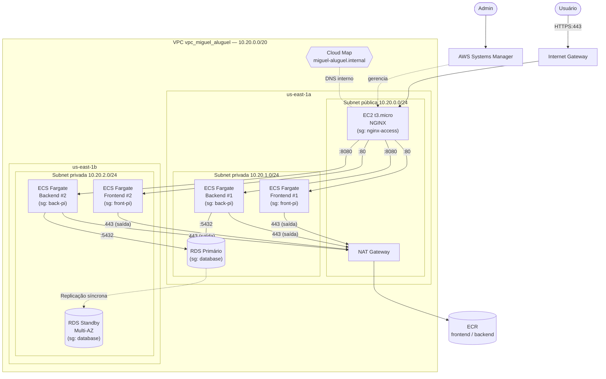

# Infraestrutura AWS com Terraform — Projeto Aluguel

Este repositório contém o código Terraform que provisiona, de ponta a ponta, a infraestrutura na AWS definida no diagrama de arquitetura do projeto (`diagrama_infra_pI_4_drawio.pdf`). Cada componente do diagrama possui um recurso correspondente no Terraform, de modo que `terraform apply` entrega o ambiente exatamente como foi desenhado.

---

## Sumário

1. [Visão geral](#visão-geral)
2. [Diagrama da arquitetura](#diagrama-da-arquitetura)
3. [Mapeamento diagrama → Terraform](#mapeamento-diagrama--terraform)
4. [Rede](#rede)
5. [Segurança (Security Groups)](#segurança-security-groups)
6. [Computação](#computação)
7. [Banco de dados](#banco-de-dados)
8. [Service Discovery (Cloud Map)](#service-discovery-cloud-map)
9. [Registro de imagens (ECR)](#registro-de-imagens-ecr)
10. [Acesso administrativo (SSM)](#acesso-administrativo-ssm)
11. [Fluxos de tráfego](#fluxos-de-tráfego)
12. [Pré-requisitos](#pré-requisitos)
13. [Como usar](#como-usar)
14. [Estrutura do projeto](#estrutura-do-projeto)
15. [Decisões de projeto](#decisões-de-projeto)

---

## Visão geral

| Item | Valor |
|---|---|
| Provedor | AWS |
| Região | `us-east-1` (N. Virginia) |
| VPC | `vpc_miguel_aluguel` — `10.20.0.0/20` |
| Zonas de disponibilidade | `us-east-1a` e `us-east-1b` |
| Ponto de entrada | EC2 `t3.micro` com **Nginx** (reverse proxy) |
| Aplicação | Frontend e Backend em **ECS Fargate** (2 réplicas de cada, uma por AZ) |
| Banco de dados | **Amazon RDS** com **Multi-AZ** (primário + standby) |
| Descoberta de serviços | **AWS Cloud Map** (DNS privado) |
| Imagens de contêiner | **Amazon ECR** (frontend e backend) |
| Acesso administrativo | **AWS Systems Manager** (sem necessidade de expor SSH) |

A arquitetura segue o princípio de **menor exposição**: somente o Nginx fica em subnet pública. Frontend, backend e banco ficam em subnets privadas, e cada camada só aceita tráfego da camada imediatamente anterior, controlado por Security Groups encadeados.

---

## Diagrama da arquitetura



---

## Mapeamento diagrama → Terraform

| Componente no diagrama | Recurso Terraform |
|---|---|
| VPC `vpc_miguel_aluguel` | `aws_vpc.vpc_miguel_aluguel` |
| Subnet pública `10.20.0.0/24` (1a) | `aws_subnet` |
| Subnets privadas `10.20.1.0/24` (1a) e `10.20.2.0/24` (1b) | `aws_subnet` |
| Internet Gateway | `aws_internet_gateway` |
| NAT Gateway | `aws_nat_gateway` + `aws_eip` |
| Tabelas de rotas (pública e privadas) | `aws_route_table` + `aws_route_table_association` |
| EC2 `t3.micro` com Nginx | `aws_instance` |
| `sg-app-access` | `aws_security_group.app_access` (`nginx-access`) |
| `sg-frontend` | `aws_security_group.front-pi` |
| `sg-backend` | `aws_security_group.back-pi` |
| `sg-database` | `aws_security_group.rds-pi` (`database`) |
| Regras dos Security Groups | `aws_vpc_security_group_ingress_rule` / `aws_vpc_security_group_egress_rule` |
| ECS Fargate (Frontend #1 e #2, Backend #1 e #2) | `aws_ecs_cluster`, `aws_ecs_task_definition`, `aws_ecs_service` |
| RDS primário + standby (Multi-AZ) | `aws_db_subnet_group` + `aws_db_instance` (`multi_az = true`) |
| Cloud Map | `aws_service_discovery_private_dns_namespace` + `aws_service_discovery_service` |
| ECR (frontend e backend) | `aws_ecr_repository` (x2) |
| AWS Systems Manager | `aws_iam_role` + `aws_iam_instance_profile` (política `AmazonSSMManagedInstanceCore`) |

---

## Rede

**VPC:** `vpc_miguel_aluguel`, CIDR `10.20.0.0/20` (4.096 endereços).

| Subnet | CIDR | AZ | Tipo | Conteúdo |
|---|---|---|---|---|
| Pública | `10.20.0.0/24` | `us-east-1a` | Pública | EC2 Nginx, NAT Gateway |
| Privada 1 | `10.20.1.0/24` | `us-east-1a` | Privada | Frontend #1, Backend #1, RDS primário |
| Privada 2 | `10.20.2.0/24` | `us-east-1b` | Privada | Frontend #2, Backend #2, RDS standby |

**Roteamento:**

- **Subnet pública** → rota `0.0.0.0/0` para o **Internet Gateway**.
- **Subnets privadas** → rota `0.0.0.0/0` para o **NAT Gateway**, permitindo que as tarefas Fargate baixem imagens do ECR e acessem serviços externos sem ter IP público.

---

## Segurança (Security Groups)

Os Security Groups são **encadeados por referência** (um SG autoriza outro SG, e não faixas de IP), de modo que só o componente certo consegue falar com o próximo.

> **Observação técnica:** como `nginx-access` ↔ `front-pi` e `nginx-access` ↔ `back-pi` se referenciam mutuamente (ingress de um é egress do outro), os SGs são criados **sem regras inline** e as regras são declaradas em recursos separados (`aws_vpc_security_group_*_rule`). Isso evita o erro de *Cycle* no Terraform.

### `nginx-access` (diagrama: `sg-app-access`)

| Direção | Porta | Origem / Destino |
|---|---|---|
| Entrada | 80/tcp | `0.0.0.0/0` |
| Entrada | 443/tcp | `0.0.0.0/0` |
| Saída | 80/tcp | SG `front-pi` |
| Saída | 8080/tcp | SG `back-pi` |

### `front-pi` (diagrama: `sg-frontend`)

| Direção | Porta | Origem / Destino |
|---|---|---|
| Entrada | 80/tcp | SG `nginx-access` |
| Saída | 443/tcp | `0.0.0.0/0` (via NAT: ECR e serviços externos) |

### `back-pi` (diagrama: `sg-backend`)

| Direção | Porta | Origem / Destino |
|---|---|---|
| Entrada | 8080/tcp | SG `nginx-access` |
| Saída | 443/tcp | `0.0.0.0/0` (via NAT: ECR e serviços externos) |
| Saída | 5432/tcp | SG `database` |

### `database` (diagrama: `sg-database`)

| Direção | Porta | Origem / Destino |
|---|---|---|
| Entrada | 5432/tcp | SG `back-pi` |

> Somente o backend alcança o banco. Frontend e Nginx não têm caminho de rede até o RDS.

---

## Computação

### Nginx (reverse proxy) — EC2

- Instância **`t3.micro`** na subnet pública, `us-east-1a`.
- Associada ao SG `nginx-access`.
- É o **único ponto de entrada público** da aplicação (portas 80/443).
- Encaminha as requisições para o frontend (porta `80`) e para o backend (porta `8080`) usando os nomes DNS do Cloud Map.

### Frontend e Backend — ECS Fargate

| Serviço | Réplicas | Subnets | Porta | Security Group |
|---|---|---|---|---|
| Frontend | 2 (#1 em 1a, #2 em 1b) | Privadas | 80 | `front-pi` |
| Backend | 2 (#1 em 1a, #2 em 1b) | Privadas | 8080 | `back-pi` |

- Execução em **Fargate** (sem gerenciar servidores).
- Uma réplica de cada serviço por AZ, garantindo **alta disponibilidade**: se uma AZ falhar, a outra continua atendendo.
- Imagens puxadas do ECR através do NAT Gateway.
- Registradas automaticamente no Cloud Map.

---

## Banco de dados

- **Amazon RDS (PostgreSQL)** com **Multi-AZ** habilitado.
- **Primário** em `us-east-1a` (subnet `10.20.1.0/24`) e **standby** em `us-east-1b` (subnet `10.20.2.0/24`).
- **Replicação síncrona** entre as instâncias: em caso de falha do primário, o RDS promove o standby automaticamente.
- Criado em um **DB Subnet Group** contendo as duas subnets privadas.
- Sem acesso público; aceita conexões apenas do SG `back-pi` na porta `5432`.

---

## Service Discovery (Cloud Map)

Namespace DNS privado **`miguel-aluguel.internal`**, vinculado à VPC:

| Serviço | Endereço interno |
|---|---|
| Backend | `backend.miguel-aluguel.internal:8080` |
| Frontend | `frontend.miguel-aluguel.internal:80` |

O Nginx usa esses nomes para localizar as tarefas Fargate, sem depender de IPs fixos (que mudam a cada nova tarefa).

---

## Registro de imagens (ECR)

Dois repositórios:

- `frontend` — imagem do frontend
- `backend` — imagem do backend

As tarefas Fargate puxam as imagens a partir das subnets privadas, saindo pelo **NAT Gateway**.

---

## Acesso administrativo (SSM)

O administrador acessa a infraestrutura pelo **AWS Systems Manager**, sem precisar expor portas de gerenciamento à internet. A instância EC2 recebe uma **IAM Role** com a política `AmazonSSMManagedInstanceCore` por meio de um *instance profile*.

---

## Fluxos de tráfego

**1. Requisição do usuário**

```
Usuário ──HTTPS:443──▶ Internet Gateway ──▶ Nginx (EC2, subnet pública)
                                              ├──:80───▶ Frontend (Fargate)
                                              └──:8080─▶ Backend  (Fargate) ──:5432──▶ RDS
```

**2. Saída das aplicações (ex.: pull de imagens)**

```
Frontend / Backend (subnet privada) ──443──▶ NAT Gateway ──▶ Internet / ECR
```

**3. Alta disponibilidade do banco**

```
RDS primário (1a) ══ replicação síncrona ══▶ RDS standby (1b)
```

**4. Administração**

```
Admin ──▶ AWS Systems Manager ──▶ EC2 / recursos da VPC
```

---

## Pré-requisitos

- [Terraform](https://developer.hashicorp.com/terraform/install) `>= 1.5`
- Provider `hashicorp/aws` `>= 5.x` (necessário para `aws_vpc_security_group_*_rule`)
- [AWS CLI](https://docs.aws.amazon.com/cli/latest/userguide/getting-started-install.html) configurado (`aws configure`)
- Permissões IAM para criar VPC, EC2, ECS, ECR, RDS, Cloud Map, IAM e SSM

---

## Como usar

```bash
# 1. Entrar no diretório do Terraform
cd infra/terraform

# 2. Inicializar providers e backend
terraform init

# 3. Validar a sintaxe
terraform validate

# 4. Visualizar o que será criado
terraform plan

# 5. Provisionar a infraestrutura
terraform apply

# 6. Destruir o ambiente quando não for mais necessário
terraform destroy
```

---

## Estrutura do projeto

```
terraform_lab/
└── infra/
    └── terraform/
        ├── provider.tf          # provider AWS 
        ├── network.tf           # VPC, subnets, IGW, NAT, rotas
        ├── security.tf          # Security Groups e regras
        ├── compute.tf           # instância Nginx, cluster, task definitions e services
        ├── database.tf          # subnet group e instância RDS Multi-AZ
        ├── cloudmap.tf          # namespace e serviços de discovery para resolução de dns interno para o nginx
        ├── outputs.tf           # outputs com ips gerados
        ├── terraform.tfvars.ex  # arquivo de template para criar o terraform.vars com a definição dos valores para as variaveis
        └── variables.tf         # variaveis usadas para prover a infra e a aplicação Miguel Aluguel
    └── diagrama/
        ├── diagrama_infraestrutura.pdf # diagrama da infra criada pelo terraform


```


---

## Decisões de projeto

- **Subnets privadas para a aplicação e o banco:** nenhum componente além do Nginx é alcançável diretamente pela internet.
- **Security Groups por referência:** em vez de liberar faixas de IP, cada camada confia apenas no SG da camada anterior.
- **Regras de SG em recursos separados:** evita dependências circulares entre `nginx-access`, `front-pi` e `back-pi`.
- **Egress restrito:** frontend e backend só saem pela porta 443 (e o backend também para o RDS na 5432), reduzindo a superfície em caso de comprometimento.
- **Duas réplicas em AZs distintas:** tolerância a falha de uma zona inteira.
- **RDS Multi-AZ:** failover automático do banco, com replicação síncrona.
- **Cloud Map:** comunicação por nome DNS, sem IPs fixos.
- **SSM no lugar de SSH:** acesso administrativo auditável e sem portas de gerência expostas.
